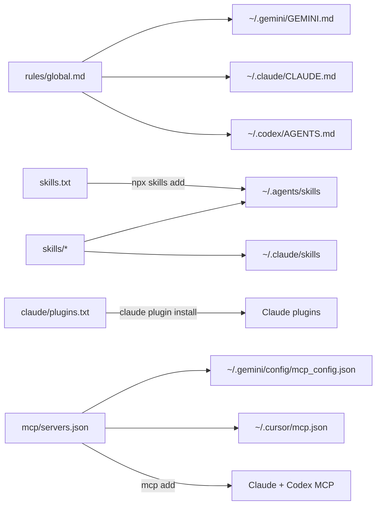

# agent-kit

One source of truth for my AI coding setup — global rules, skills, plugins, MCP servers and
subagents — shared by **Claude Code, Codex, Antigravity (agy), Cursor and Junie**, installed with
one script.

Edit files here, re-run `./install.sh`, and every tool picks up the change. No more hand-editing
five config dirs that drift apart.

## What links where

`install.sh` symlinks repo files into each tool's config dir:

| Repo source | Linked to | Read by |
|---|---|---|
| `rules/global.md` | `~/.gemini/GEMINI.md`<br>`~/.claude/CLAUDE.md`<br>`~/.codex/AGENTS.md` | Antigravity<br>Claude Code<br>Codex |
| `skills/<name>/` | `~/.agents/skills/<name>`<br>`~/.claude/skills/<name>` | Codex, Cursor, Antigravity, Junie<br>Claude Code |
| `agents/antigravity/*.md` | `~/.gemini/config/agents/<file>` | Antigravity subagents |
| `mcp/servers.json` | `~/.gemini/config/mcp_config.json`<br>`~/.cursor/mcp.json` | Antigravity<br>Cursor |

Plus CLI steps (each skipped if the CLI isn't installed, all skipped with `--links-only`):

| Repo source | Step |
|---|---|
| `skills.txt` | `npx -y skills add <line> -g -y` per line → third-party packs into `~/.agents/skills` |
| `claude/plugins.txt` | add missing marketplaces, `claude plugin install` missing plugins |
| `mcp/servers.json` | `claude mcp add-json -s user …` / `codex mcp add …` for servers not yet registered |



> **Third-party packs reach Claude differently.** Claude Code does not read `~/.agents/skills`.
> It gets superpowers / caveman / ponytail / grill etc. as **plugins** (`claude/plugins.txt`).
> Every other tool gets the same packs as **skills** via `skills.txt` → `~/.agents/skills`.
> My own skills in `skills/` are linked into both places.

## Quick start

```bash
git clone https://github.com/bo-xd/agent-kit.git ~/Coding/agent-kit
cd ~/Coding/agent-kit
./install.sh --dry-run      # print every action, change nothing
./install.sh                # link everything + run npx/claude/codex steps
./install.sh --check        # OK / MISSING / WRONG per link; non-zero exit if anything is off
```

| Flag | Does |
|---|---|
| *(none)* | links + third-party skills + Claude plugins + MCP registration |
| `--dry-run` | print actions only |
| `--check` | verify links, exit non-zero on any problem |
| `--links-only` | symlinks only; skip all `npx` / `claude` / `codex` steps (offline-safe) |
| `--help` | usage |

The script is idempotent: re-running it is a no-op when everything is already in place.

## Repo layout

```
rules/global.md                 global rules for every agent
skills/<name>/SKILL.md          my own skills (see docs/WORKFLOW.md)
skills.txt                      third-party skill packs (one `npx skills add` arg list per line)
claude/plugins.txt              Claude marketplaces + plugin ids
mcp/servers.json                shared MCP servers ({"mcpServers": {...}})
agents/antigravity/*.md         Antigravity subagents
templates/AGENTS.md             starting point for a project's AGENTS.md
hooks/                          optional safety hooks (see hooks/README.md)
prompts/                        reusable high-leverage prompt library
docs/WORKFLOW.md                playbook: which tool / skill when, prompts that work
AGENTS.md                       instructions for agents editing this repo
```

## Adding things

**A skill of my own** — create `skills/<name>/SKILL.md` with frontmatter:

```markdown
---
name: <name>            # must match the dir name
description: Does X. Use when Y.
---
```

Run `./install.sh --links-only`. It's linked into `~/.agents/skills` and `~/.claude/skills`
automatically (every dir under `skills/` is picked up). Use the `writing-skills` skill for guidance.

**A third-party skill pack** — add a line to `skills.txt` with the arguments you'd pass to
`npx skills add`, e.g. `obra/superpowers` or `owner/repo --skill name`. Check it first with
`npx -y skills add <src> -l` (lists without installing). If the pack also ships a Claude plugin,
add it to `claude/plugins.txt` too — otherwise Claude won't see it.

**A Claude plugin** — add a `plugin <plugin>@<marketplace>` line (and `marketplace <name> <owner/repo>` if not built in) to `claude/plugins.txt`, then run `./install.sh`.

**An MCP server** — add an entry to `mcp/servers.json`:

```json
{ "mcpServers": { "context7": { "command": "npx", "args": ["-y", "@upstash/context7-mcp"] } } }
```

Antigravity and Cursor read the file directly (symlink); `./install.sh` registers new servers with
Claude and Codex. **No secrets in this file** — it's committed. Servers that need API keys or are
personal (e.g. whatsapp) stay in the tool's own config.

## Backups and undo

Before linking, any real file or foreign symlink at a target is **moved** to
`~/.agent-kit-backups/<timestamp>/<same path relative to ~>`. Nothing is deleted.

To undo, for each target you want back:

```bash
rm ~/.claude/CLAUDE.md                                            # remove the symlink
mv ~/.agent-kit-backups/<timestamp>/.claude/CLAUDE.md ~/.claude/  # restore the original
```

`ls -R ~/.agent-kit-backups/<timestamp>` shows exactly what was moved. Plugins and MCP servers that
were added via CLI can be removed with `claude plugin uninstall <id>`, `claude mcp remove <name>`,
`codex mcp remove <name>`.

## Intentionally not managed

- Tool settings files (`~/.claude/settings.json`, `~/.codex/config.toml`, …) — machine-specific.
- Secrets and API keys.
- Personal MCP servers (e.g. whatsapp).
- Copilot / Junie-specific config beyond what `~/.agents/skills` already gives them.
- Per-project `AGENTS.md` files — those live in each project (start from `templates/AGENTS.md`).
