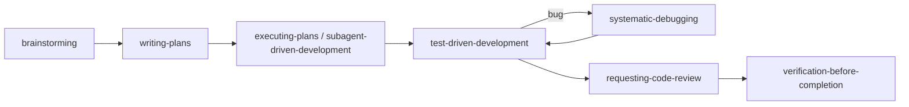

# Workflow playbook

How to actually use this setup day to day. Skills are invoked by name ("use the
systematic-debugging skill") or picked up automatically when the description matches.

## Which tool for what

| Task | Reach for | Why |
|---|---|---|
| Multi-file feature, refactor, long agentic run | **Claude Code** or **Antigravity (agy)** | Best planning + subagents; all skills/plugins loaded |
| Long unattended task ("finish this overnight") | **agy** with `/goal` | Keeps going until the goal is verified |
| Second opinion / code review of a diff | **Codex** (`/review`) | Different model = different blind spots |
| Editing while you read the code yourself | **Cursor** | Inline edits, tab-complete, you stay in control |
| Java / Kotlin / JetBrains projects | **Junie** | Lives in the IDE that already understands the project |
| Quick "what does this flag do" | any, or just the man page | Don't burn an agent run on a lookup |

All of them share the same global rules (`rules/global.md`) and the same skills, so switching tools
mid-task is fine — paste the plan file, not the chat history.

## The skill flow (superpowers)

| Step | Skill | Use when |
|---|---|---|
| 1 | `brainstorming` | Anything new. Agent asks questions, proposes 2–3 approaches, writes a short design. |
| 2 | `writing-plans` | Design is agreed. Produces a step-by-step plan with exact files and tests. |
| 3 | `executing-plans` / `subagent-driven-development` | Run the plan yourself step by step, or fan independent tasks out to subagents. |
| 4 | `test-driven-development` | Every feature/bugfix: failing test first, then code. |
| 5 | `systematic-debugging` | A test fails or behaviour is weird. Root cause before fixes. |
| 6 | `requesting-code-review` / `receiving-code-review` | Before merging; and when evaluating review feedback critically. |
| 7 | `verification-before-completion` | Before saying "done": run the commands, read the output. |

Shortcuts: tiny fix → skip 1–3, go straight to TDD (`surgical-patch` fits too). Weird failure with
no obvious cause → `investigate-first`. Restructuring code → `safe-refactor`. Branch done →
`finishing-a-development-branch`.

## caveman and ponytail

- **caveman** — terse output, same technical content. Use for long sessions where context fills up,
  quick Q&A, or when you're reading on a small screen. Say "caveman mode" / "stop caveman".
  `caveman-commit` writes compact Conventional Commit messages; `caveman-review` gives one-line
  review findings.
- **ponytail** — "lazy senior dev": smallest change that fully solves it, no speculative
  abstractions. Use when an agent tends to over-engineer, for school assignments with a narrow
  spec, or any "just fix it" task. Don't use it for design work where you *want* options.

They combine fine: ponytail decides *what* to change, caveman decides *how much it says*.

## My own skills

| Skill | Use when |
|---|---|
| `c-cpp-debugging` | Segfaults, UB, leaks, heisenbugs in C/C++ (gdb, valgrind, ASan/UBSan, CMake/Make). Pairs with `systematic-debugging`. |
| `reverse-engineering` | Crackmes, CTFs, your own binaries — **authorized targets only**. Ghidra / Binary Ninja / radare2 / strace / ltrace. |
| `security-review` | Reviewing your own code for vulns before shipping or submitting. |
| `llm-app-engineering` | Building LLM features/agents: structured output, evals, prompt versioning, cost/latency, tool use. |
| `project-agents-md` | Starting or onboarding a project: writes its `AGENTS.md` from `templates/AGENTS.md`. |
| `prompt-sharpener` | Turning a rough idea into a direct, high-leverage prompt (Objective, Context, Constraints, Done check). |
| `obsidian-vault` | Reading, searching, or saving atomic notes/postmortems in `~/Documents/Obsidian Vault`. |

Tip: run `project-agents-md` once per project. A good project `AGENTS.md` (build/test commands,
layout, gotchas) improves every tool's results more than any prompt trick.

## Prompt patterns that work

Want an agent to rewrite your rough prompt into a sharp one before running it? Say **"use prompt-sharpener on this: ..."** (or **"sharpen and run: ..."**). `rules/global.md` also tells every tool to restate underspecified tasks in 2–4 lines before editing. For ready-to-use templates (C/C++ UB audit, RE breakdown, quiz mode, cold diff review, Obsidian postmortems), see [prompts/README.md](../prompts/README.md).

- **Give the goal and the check.** "Make `make test` pass without changing the tests" beats
  "fix the tests". Agents stop when they can verify.
- **Point at files.** "In `src/lexer.c`, `next_token` mis-handles `/*` at EOF" saves a whole
  exploration phase.
- **Paste the real error.** Full compiler output / stack trace / failing test, not a summary.
- **Ask for a plan first on anything non-trivial.** "Plan only, don't edit yet" → review → "go".
- **Bound the scope.** "Only touch `renderer/`", "no new dependencies", "smallest change".
- **Ask it to interview you** when requirements are fuzzy: `/grill-me` or "ask me questions one at
  a time until you're confident".
- **Make it prove it.** "Show the command you ran and its output" — pairs with
  `verification-before-completion`.
- **Ask for learning, not just code** (school/projects): "explain why this fixes it, then let me
  write the next one". Never have an agent write reflections or AI-usage statements as if you
  wrote them.
- **New context for new tasks.** Long chats degrade. Start fresh with the plan file, or `/compact`.

## Slash commands worth knowing

| Command | Tool | Use for |
|---|---|---|
| `/plan` | agy | Plan carefully before executing a complex task |
| `/goal` | agy | Long-running task; keep going until the goal is fully met |
| `/grill-me` | agy, Claude (`grill` plugin) | Interview-style alignment on a design before building |
| `/learn` | agy | Persist a correction or setup trick for future sessions |
| `/schedule` | agy | Recurring or delayed instruction |
| `/compact` | agy, Claude, Codex | Summarize the conversation to free context |
| Shift+Tab (plan mode) | Claude | Plan without edits until you approve |
| `/review` | Codex | Review the current diff |
| `/mcp`, `/plugin` | Claude | Inspect MCP servers / manage plugins |
| `/init` | Claude, Codex | Generate a project instructions file (prefer `project-agents-md`) |
